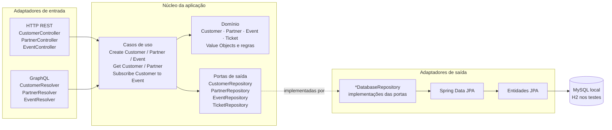
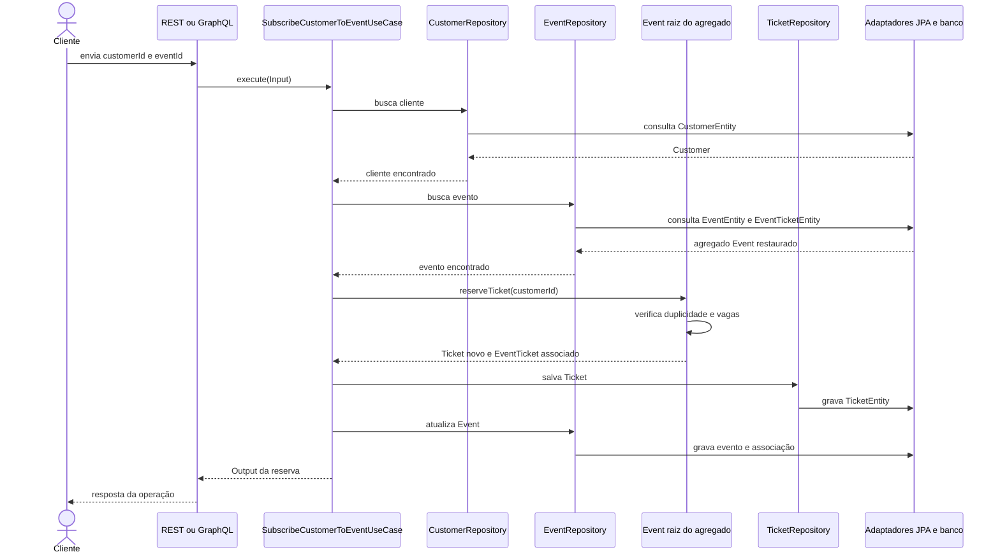

# Projeto de ingressos: Hexagonal, DDD e Spring Boot

Este repositório é um projeto didático em Java 17 e Spring Boot. Ele permite cadastrar clientes e parceiros, cadastrar eventos vinculados a parceiros e reservar ingressos para clientes.

O objetivo é estudar como regras de negócio podem ficar no núcleo da aplicação enquanto REST, GraphQL, Spring Data JPA e bancos de dados ficam nas bordas. Os exemplos também fazem paralelos com NestJS, DDD e, de forma introdutória, Clean Architecture.

## O que o sistema faz

O fluxo esperado do negócio é:

1. Cadastrar um cliente, que informa nome, CPF e e-mail.
2. Cadastrar um parceiro, que informa nome, CNPJ e e-mail.
3. Cadastrar um evento ligado a um parceiro existente, com nome, data e quantidade de vagas.
4. Reservar um ingresso para um cliente em um evento existente.
5. O evento impede uma segunda reserva do mesmo cliente e não permite ultrapassar a quantidade de vagas.

Uma reserva cria um Ticket com status inicial PENDING e registra também uma associação EventTicket dentro do estado do evento.

## Visão da arquitetura

Hexagonal, também chamada Ports and Adapters, descreve o núcleo da aplicação e as fronteiras pelas quais ele conversa com o mundo externo. O formato hexagonal é uma metáfora: não exige seis componentes nem uma organização de pastas específica.

- **Núcleo**: domínio, casos de uso e interfaces de repositório.
- **Porta de entrada**: operação oferecida pelo núcleo. Neste projeto, cada caso de uso oferece execute(Input); não existe uma interface separada para cada porta.
- **Adaptador de entrada**, ou *driver*: recebe HTTP ou GraphQL, transforma os dados externos em Input e converte o resultado para o formato da API.
- **Porta de saída**: interface que o núcleo define para expressar uma necessidade externa, como carregar ou salvar um cliente.
- **Adaptador de saída**, ou *driven adapter*: implementa uma porta usando uma tecnologia, aqui Spring Data JPA.
- **Composition root**: ponto em que as implementações concretas são conectadas aos casos de uso. Aqui, UseCaseConfig registra os casos de uso como beans Spring.

As dependências devem apontar para dentro: casos de uso dependem das interfaces de repositório, não das classes Spring Data ou do banco.



REST e GraphQL são duas entradas diferentes para os mesmos casos de uso. A aplicação não deve precisar de uma regra de negócio duplicada para cada protocolo.

### Chamadas em execução e dependências no código

É útil separar duas ideias que os diagramas podem misturar:

- **Fluxo em execução**: uma requisição chega por um adaptador de entrada, chama um caso de uso e pode seguir por uma porta até um adaptador de saída e o banco.
- **Direção da dependência no código**: o caso de uso conhece a interface da porta; o adaptador de banco conhece essa mesma interface e a implementa. O núcleo não importa a implementação concreta nem Spring Data.

Assim, o fluxo de execução pode chegar ao banco, mas as regras e os contratos do núcleo não ficam dependentes do banco. A interface do repositório é definida no lado interno; a infraestrutura aponta para ela ao implementá-la.

### Nomes das bordas

Os termos variam um pouco entre livros e autores, mas a correspondência comum é:

| Termo | Outros nomes comuns | Exemplos neste projeto |
| --- | --- | --- |
| Adaptador de entrada | *driving adapter*, *primary adapter*, driver | Controllers REST e resolvers GraphQL iniciam uma interação com a aplicação |
| Porta de entrada | *driving port*, *primary port* | Operação pública `execute(Input)` dos casos de uso; não há interfaces separadas para essas portas neste exemplo |
| Porta de saída | *driven port*, *secondary port* | Interfaces `CustomerRepository`, `EventRepository`, `PartnerRepository` e `TicketRepository` |
| Adaptador de saída | *driven adapter*, *secondary adapter* | Classes `*DatabaseRepository`, que implementam as portas com Spring Data JPA |

Porta é o contrato; adaptador é uma implementação ou um tradutor na fronteira. Por isso, um resolver GraphQL pode ser chamado de driver de entrada e de adaptador de entrada ao mesmo tempo: os nomes descrevem aspectos diferentes do mesmo componente.

### O que a arquitetura facilita

- **Trocar uma borda**: um novo adaptador HTTP, CLI ou mensageria pode chamar o mesmo caso de uso sem reescrever a regra de negócio.
- **Trocar uma implementação externa**: uma implementação em memória ou outro banco pode implementar as mesmas portas sem alterar os casos de uso.
- **Testar o núcleo isoladamente**: os testes de caso de uso usam repositórios em memória, enquanto os testes de integração verificam o caminho com Spring/JPA.

Esses benefícios dependem de preservar as fronteiras. Se tipos de Spring, JPA ou HTTP começarem a entrar nos contratos e no domínio, a aplicação passa a conhecer detalhes que deveria poder substituir.

### Limites desta implementação didática

- Os casos de uso concretos fazem o papel das portas de entrada; o projeto não cria uma interface `InputPort` para cada operação. Hexagonal não exige esse tipo de interface se a aplicação não precisa dela.
- Os contratos de saída são chamados `*Repository` porque representam acesso ao modelo persistido. O nome é uma escolha do projeto, não uma exigência da arquitetura.
- As portas de repositório incluem `deleteAll()`, usado sobretudo para preparar/limpar cenários de teste. Em uma aplicação maior, esse método poderia ficar em uma ferramenta de suporte a testes em vez de fazer parte dos contratos usados pelos casos de uso.
- A presença de portas e adaptadores não define automaticamente uma boa modelagem de domínio. A fronteira entre o agregado `Event`, `EventTicket` e a entidade `Ticket` ainda é uma decisão de DDD que pode evoluir.

### Reserva de ingresso passo a passo



O caso de uso coordena o fluxo; a raiz Event aplica as regras que protegem o evento. EventTicket registra no agregado a associação, enquanto Ticket guarda os dados completos do ingresso, inclusive status e datas. O projeto persiste Ticket e Event por portas diferentes; essa fronteira de consistência é um ponto de modelagem que pode ser refinado à medida que o projeto evoluir.

## Regras de domínio e DDD

**Domain-Driven Design (DDD)** é uma abordagem de modelagem de software centrada no domínio do negócio. A equipe procura usar os termos do negócio no código e colocar as regras junto aos conceitos que elas governam. DDD não é framework nem receita de nomes de classes.

### DDD estratégico

- **Linguagem ubíqua**: vocabulário comum entre pessoas do negócio e desenvolvimento, por exemplo Cliente, Parceiro, Evento, Reserva e Ingresso.
- **Contexto delimitado (*bounded context*)**: fronteira em que um modelo e seus termos têm significado consistente. O projeto atual é didático e trata esse fluxo como um único contexto; ainda não modela vários contextos.

### DDD tático neste projeto

- **Entidade**: tem identidade própria, que continua sendo a mesma mesmo se atributos mudarem. Customer, Partner, Event e Ticket são entidades.
- **Value Object**: expressa um conceito por seu valor, sem identidade própria. Name, Email, Cpf, Cnpj e os tipos de ID são records usados para tornar explícitos os conceitos e validar valores.
- **Invariante**: regra que deve permanecer verdadeira para o modelo ser válido. Event.reserveTicket verifica duplicidade do cliente e lotação. Os casos de uso também verificam unicidade de CPF/e-mail e existência de parceiro, cliente e evento.
- **Agregado**: grupo de objetos tratado como uma fronteira de consistência. A raiz é a entrada para alterar esse grupo e proteger suas invariantes.
- **Raiz do agregado**: Event é a raiz mais evidente no código. Contém EventTicket e expõe reserveTicket; a coleção retornada por allTickets não pode ser alterada diretamente por quem chama.
- **Repositório**: abstração para recuperar e persistir objetos do domínio sem revelar detalhes de armazenamento.

EventTicket não é o Ticket completo: é a associação que o agregado Event consulta para controlar clientes e vagas. Ticket é entidade própria, com TicketId, status e datas, e tem porta TicketRepository. O desenho atual salva Ticket e atualiza Event durante a mesma reserva. É importante compreender que a fronteira do agregado e a transação são decisões relacionadas, mas não idênticas: a transação técnica não transforma automaticamente dois objetos em um único agregado DDD.

### Validações atuais e limites conhecidos

As validações descritas aqui refletem o código, que é didático:

- CPF e CNPJ exigem o formato pontuado definido pelos records; não calculam os dígitos verificadores.
- Email usa uma expressão regular simples, que não cobre todas as regras possíveis de endereços de e-mail.
- Name rejeita null, mas atualmente aceita string vazia ou composta apenas por espaços.
- Event valida que data, parceiro e totalSpots não sejam null; a implementação atual não rejeita totalSpots negativo.
- Os construtores dos records de ID rejeitam null, mas só os métodos with validam que o valor seja UUID.
- TicketStatus declara PENDING, PROCESSING e PAID, mas o fluxo atual só cria Ticket em PENDING e não implementa transições de pagamento.
- A exceção lançada por Event ao detectar reserva duplicada atualmente usa a mensagem “Email already registered”, embora a condição verificada seja cliente já associado ao evento.

Esses itens são observações sobre o código presente, não regras recomendadas para um produto real.

## Estrutura atual

```text
src/main/java/br/com/fullcycle/hexagonal/
├── application/                         # núcleo: domínio, casos de uso e portas
│   ├── domain/
│   │   ├── customer/                    # Customer e CustomerId
│   │   ├── event/                       # raiz Event, EventId e EventTicket
│   │   │   └── ticket/                  # Ticket, TicketId e TicketStatus
│   │   ├── partner/                     # Partner e PartnerId
│   │   └── person/                      # Name, Email, Cpf e Cnpj
│   ├── exceptions/                      # ValidationException
│   ├── repositories/                    # portas de saída
│   └── usecases/                        # operações da aplicação e contratos base
└── infrastructure/                      # detalhes de entrada, framework e persistência
    ├── configurations/                  # composição dos casos de uso com @Bean
    ├── dtos/                            # records de entrada das APIs
    ├── graphql/                         # resolvers: adaptadores de entrada
    ├── jpa/
    │   ├── entities/                    # modelos JPA de persistência
    │   └── repositories/                # interfaces Spring Data JPA
    ├── repositories/                    # adaptadores que implementam as portas
    ├── rest/                            # controllers: adaptadores de entrada
    └── Main.java                        # inicialização Spring Boot

src/test/java/                            # testes de domínio, casos de uso, REST e integração
```

A pasta application é o núcleo da aplicação neste desenho; domain fica dentro dela por organização do projeto, não por exigência da arquitetura hexagonal. Domínio e casos de uso continuam sendo conceitos diferentes. Clean Architecture costuma desenhar entidades e casos de uso em círculos internos separados; isso é compatível com pastas aninhadas como application/domain. Hexagonal enfatiza portas/adaptadores; Clean Architecture enfatiza camadas e a regra de dependência. Podemos mapear Clean Architecture com mais profundidade quando o projeto passar a estudá-la.

## Paralelo com NestJS

A ideia central é a mesma: um caso de uso deve depender de abstrações, enquanto o framework monta implementações concretas.

| Projeto Java/Spring | Analogia NestJS | Papel |
| --- | --- | --- |
| Interface CustomerRepository | Token de provider, geralmente Symbol/string, mais contrato TypeScript | Contrato que o caso de uso consome |
| CustomerDatabaseRepository | Provider registrado no módulo com useClass ou useFactory | Implementação concreta que usa o banco |
| UseCaseConfig | Módulo/composition root com providers | Monta dependências e casos de uso |
| Método @Bean | Factory de provider / useFactory | Constrói e registra uma instância |
| Construtor do caso de uso | Argumentos da factory e lista inject | Declara dependências necessárias |
| Controller REST ou Resolver GraphQL | Controller/Resolver Nest | Adaptador de entrada |

Em TypeScript, interfaces não existem em runtime; por isso o Nest precisa de um token para resolver um provider pela interface. Em Java, a interface existe como tipo em runtime, mas o contêiner Spring ainda precisa saber qual bean concreto usar. Aqui @Component registra os adaptadores de persistência, e UseCaseConfig recebe as portas e expõe os casos de uso com @Bean.

Exemplo conceitual no Nest, equivalente à composição explícita:

```typescript
const CUSTOMER_REPOSITORY = Symbol('CUSTOMER_REPOSITORY');

const providers = [
  {
    provide: CUSTOMER_REPOSITORY,
    useClass: CustomerDatabaseRepository,
  },
  {
    provide: CreateCustomerUseCase,
    useFactory: (repository: CustomerRepository) =>
      new CreateCustomerUseCase(repository),
    inject: [CUSTOMER_REPOSITORY],
  },
];
```

Este exemplo é uma analogia, não código executado por este repositório.

## Injeção e annotations Spring presentes

- **@Configuration**: marca uma classe de configuração Spring que declara beans.
- **@Bean**: registra como bean o objeto retornado pelo método; aqui os métodos constroem os casos de uso.
- **@Component**: registra uma classe no component scan; é usado nos adaptadores de repositório.
- **@RestController**: registra um controller REST e serializa valores de retorno no corpo HTTP.
- **@RequestMapping**: define o caminho base de um controller.
- **@PostMapping / @GetMapping**: associam métodos a operações HTTP POST e GET.
- **@RequestBody / @PathVariable**: leem, respectivamente, o corpo da requisição e um trecho variável do caminho.
- **@ResponseStatus**: define o status HTTP esperado para a resposta do método.
- **@Controller** nos resolvers: registra componentes reconhecidos pelo Spring GraphQL; não significa que o resolver seja o caso de uso.
- **@MutationMapping / @QueryMapping / @Argument**: conectam métodos Java às mutations, queries e argumentos do schema GraphQL.
- **@Transactional**: define uma fronteira transacional Spring. Atualmente aparece em alguns métodos dos adaptadores REST/GraphQL e nos métodos de escrita dos adaptadores de persistência. Isso é detalhe de infraestrutura, mesmo quando envolve uma operação de aplicação.
- **@Entity / @Table / @Id**: mapeiam classes e identificadores para persistência JPA.
- **@OneToMany / @ManyToOne**: mapeiam associações entre entidades JPA; não definem, sozinhas, as fronteiras dos agregados DDD.
- **@Enumerated(EnumType.STRING)**: persiste o nome do enum como texto.
- **@SpringBootApplication**: configura a inicialização e o component scan do Spring Boot.

Não há @Autowired nem @Service no código principal atual. Em construtor único o Spring injeta dependências sem @Autowired; @Service é um estereótipo especializado de @Component, mas o projeto registra as classes de repositório com @Component e os casos de uso via @Bean. Spring Boot 3 usa namespaces jakarta para JPA; isso não deve ser confundido com injeção de dependências.

## Endpoints e operações GraphQL

### REST

| Método e caminho | Operação | Resultado esperado |
| --- | --- | --- |
| POST /customers | Criar cliente | 201 Created; validação retorna 422 |
| GET /customers/{id} | Consultar cliente | 200 OK ou 404 Not Found |
| POST /partners | Criar parceiro | 201 Created; validação retorna 422 |
| GET /partners/{id} | Consultar parceiro | 200 OK ou 404 Not Found |
| POST /events | Criar evento para parceiro existente | 201 Created; validação retorna 422 |
| POST /events/{id}/subscribe | Reservar ingresso para cliente | 200 OK; regra de negócio retorna 422 |

IDs são UUIDs em texto. Para criar evento, use o ID de parceiro retornado anteriormente. Para reservar, use IDs existentes de cliente e evento. Não existe atualmente GET /events/{id} no controller REST.

### GraphQL

GraphQL está disponível em /graphql e GraphiQL está habilitado em /graphiql. O schema está em src/main/resources/graphql/schema.gqls.

- Queries: customerOfId(id), partnerOfId(id).
- Mutations: createCustomer(input), createPartner(input), createEvent(input), subscribeCustomerToEvent(input).
- Não há query GraphQL para evento no schema nem no EventResolver atual.
- O schema GraphQL atual não expõe partnerId no tipo Event nem ticketId no tipo Subscribe, mesmo que os Outputs Java tenham essas propriedades.

Veja os exemplos completos em [docs/graphql-examples.md](docs/graphql-examples.md).
Exemplos de requisições REST, em ordem para criar as entidades e reservar um ingresso, estão em [docs/rest-examples.md](docs/rest-examples.md).

## Executar e testar

Requisitos: Java 17 e Docker para executar a configuração local de MySQL.

1. Inicie o banco local com docker compose up -d.
2. A aplicação usa MySQL em localhost:3306, banco events, usuário root e senha root, conforme src/main/resources/application.properties.
3. Execute ./gradlew bootRun.
4. Acesse REST em localhost:8080 e GraphiQL em localhost:8080/graphiql.

A configuração de testes usa o perfil test e H2 em memória. Para executar a suíte, use ./gradlew test. Os testes abrangem domínio, casos de uso, endpoints REST e integração JPA.

```json
{
  "name": "Nome do cliente",
  "email": "cliente@example.com",
  "cpf": "123.456.789-00"
}
```

Esse JSON é o corpo ilustrativo para POST /customers. Para os demais formatos, veja docs/graphql-examples.md e os records DTO em infrastructure/dtos.

## Como continuar estudando

Ao seguir evoluindo o projeto, para cada funcionalidade nova pergunte:

1. Qual regra pertence ao domínio e qual é apenas fluxo de aplicação?
2. Qual caso de uso representa a intenção do usuário?
3. Qual adaptador recebe a entrada? REST, GraphQL ou outro?
4. Quais portas de saída o caso de uso precisa?
5. Qual adaptador implementa cada porta?
6. Que invariantes o agregado deve proteger?
7. Quais testes verificam regra de domínio, fluxo do caso de uso e integração externa?

